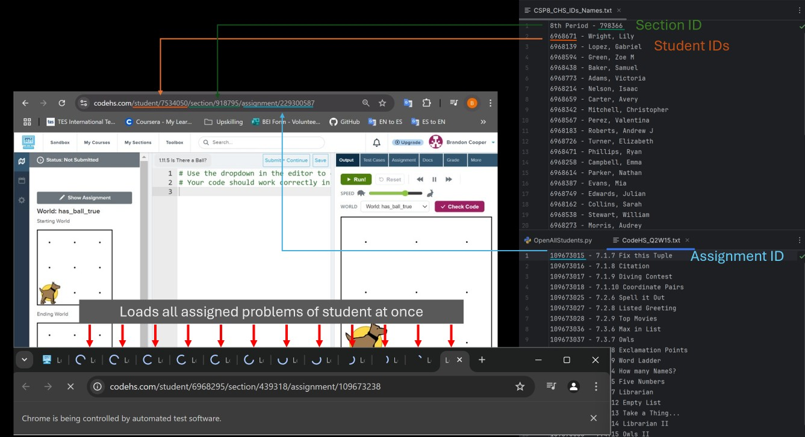
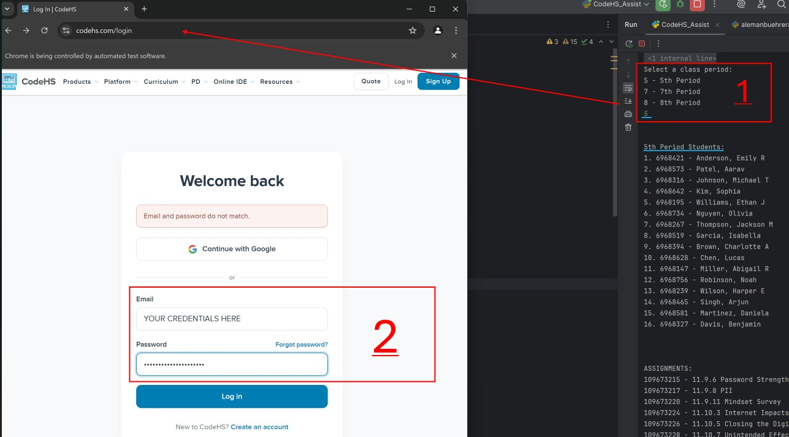

# CodeHS Free Plan Assignment Viewer in Python

#### Streamlines the grading workflow for CodeHS Free Plan.

Eliminates repetitive browser navigation and reduces time spent waiting for student assignments to load.

Many online computer science curriculums offer great content in the form of problems to be solved. However, navigation between students, courses, or assignments can often be a very tedious process. This program allows the user to cut down on the time required to grade by taking advantage of the URL structure that organizes courses, students, and assignment IDs.

## What I learned:

Using the Selenium Library to automate opening various web pages of a students work. This process can be repeated for various websites for work I wish to assign to students by helping assess student completion.

## The Problem:

CodeHS offers a comprehensive AP computer science curriculum , but many of its grading and classroom management features require an _*expensive*_ school or district license. School's might be unable to pay for the license, but teachers still use this curriculum.

Without these paid features, reviewing student submissions becomes a time-consuming process. Teachers must individually locate and open each student's assignment through the CodeHS interface.

This creates two major inefficiencies:

- Repetitive navigation: Every assignment requires manually locating and selecting its corresponding icon in the CodeHS interface.
- Sequential loading: Each assignment takes time to load in the browser. Opening assignments individually introduces repeated waiting periods throughout the grading process.

These inefficiencies compound when reviewing multiple assignments across dozens of students.

In a math class, a problem packet is already organized when it is handed out and returned. With the free version of CodeHS, it is up to the teacher to assemble the said packet if they want to grade efficiently _and_ precisely.

## The Solution:

I developed a Python program that automates assignment navigation and takes advantage of concurrent browser loading.

The program reads two text files containing student, class, and assignment IDs (IDs in the files have been made up). It then constructs the corresponding CodeHS URLs and opens the requested assignments in separate browser tabs.

    

This approach saves time by:

1. Eliminating tedious manual navigation: Teachers no longer need to locate and click individual assignment icons in a haystack of icons.

2. Reducing cumulative loading delays: Opening multiple tabs in rapid succession allows the browser to load assignments concurrently rather than requiring the teacher to wait for each page or problem to execute individually.

As a result, I can transition directly into reviewing student work rather than spending time navigating and waiting for pages to load.

## How It Works

 

1. Starting the Program: When the program runs, the teacher is prompted to choose which class to begin with, according to the menu options provided.
     
2. Logging In: The CodeHS Login Page will be launched in a separate browser after a class is selected where the teacher will enter their credentials.
   - The teacher may optionally enter their CodeHS credentials to allow the program to automatically log in to CodeHS each time it runs.

  
3. Select a Student: Once the teacher is logged in, they may continue in the console window and choose a student to begin with according to the menu. This allows teacher to pause a grading session and resume later without restarting from the beginning of the class.
   - Student IDs folder - Should contain a separate text file for each class that contains the class ID, and all student IDs for CodeHS.
   - Assignment IDs folder - Should contain a text file of each homework sets assignment IDs.
   - See sample files provided

    

4. Automated URL Generation: When a student is selected, the browser immediately opens up the student's student overview page, and all selected assignments.
   - The program generates a URL according to the section, student, and assignment IDs provided in the file.
   - Each assignment is opened in a separate browser tab, allowing multiple pages to load concurrently. Teachers can then make a pass over each tab (Ctrl+Tab on Windows) executing each program, and make a final pass to evaluate each output.

   - Eliminates the search and selection of each assignment <!-- Image Here -->.
   - Allows each assignment to load concurrently, and allows for each program to run concurrently drastically reducing wait time.

5. Student Navigation: The teacher cycles through students in the class roster to continue grading their assignments. When done with one student's assignments, close down all tabs, but the original browser tab, and continue in the menu of the console window.
